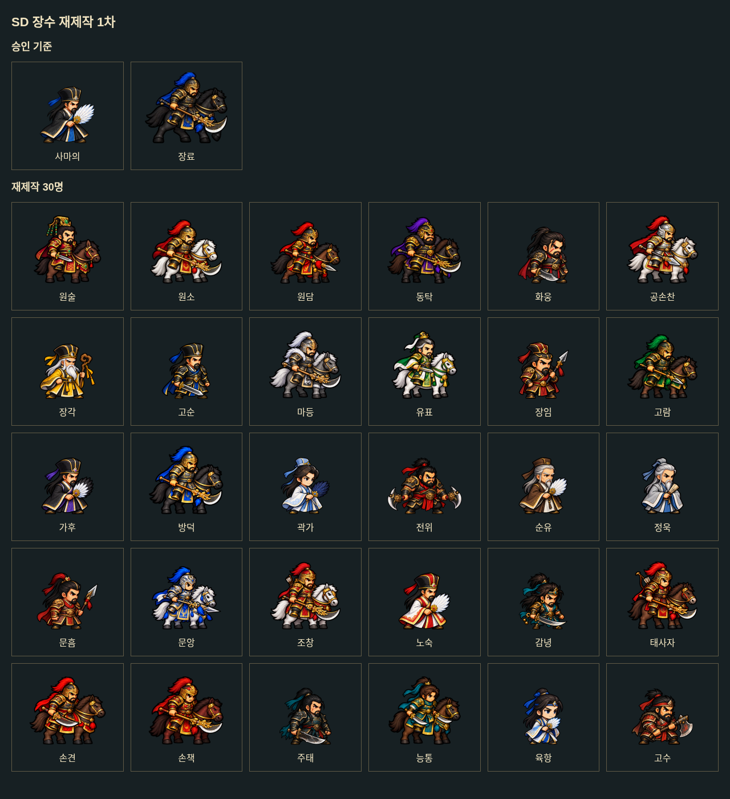
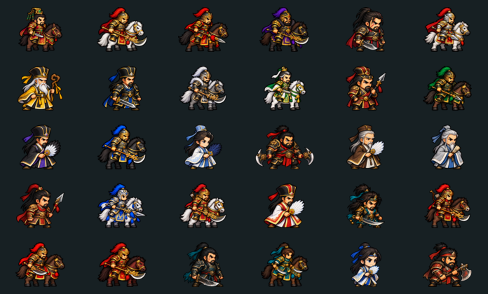

# SD 장수 재제작 기준 — 2026-10-15

사용자 최신 지시가 이전 디자인 지시서의 화풍 기준보다 우선한다.

## 승인 기준

- 도보: `sima_yi-sd-v2.webp`의 큰 머리, 짧은 몸통과 다리, 간결하고 단단한 실루엣.
- 기마: `zhang_liao-sd-v1.webp`의 장수·말 비율. 말의 몸통을 길게 빼지 않는다.
- 기존 승인 장수 사마의·하후연·장료·장합·조비·조예는 변경하지 않는다. 첨부에서 확인한 조조·조홍·사마사·사마소도 이번 묶음에서 제외한다.
- 초상화는 색감·분위기·복장·무기 특징만 참고한다. 초상화 얼굴을 축소하거나 그대로 다시 그리지 않는다.
- 길쭉한 체형, 과도하게 넓은 실루엣, 긴 말, 세밀한 전신 일러스트, 불투명 배경은 불합격이다.

## 제작·납품

사용자가 정한 수량으로 묶어 진행한다(1차 30명, 2차 50명). 승인 SD만 화풍 참고로 제공하고, 오류가 있는 기존 그림은 이미지 참조로 넣지 않는다.

장수마다 대기·이동·공격·방어/피격 네 자세를 새로 만든다. 생성 원본은 2×2로 분리해 확보할 수 있지만 게임에는 350×280 네 칸의 1400×280 투명 WebP로 납품한다. 원본 그림은 가로·세로 공통 축척으로만 줄인다. 공격 동작 때문에 무기 끝이 넓어지는 경우에도 인물 몸을 가로로 늘리거나 납작하게 압축하지 않는다.

SD 발끝선은 268px, 일기토는 230px이다. 긴 무기는 세우거나 대각선으로 접어 한 칸 안에 담는다. 일기토도 동일한 새 캐릭터로 연결한다. 그림자·지면·문자·빛 효과는 그림에 넣지 않는다.

## 검수

1. 실제 알파 채널을 검사한다. 체크무늬를 그려 놓은 RGB 그림은 투명 이미지가 아니다.
2. 어두운 단색 배경에 합성한 검수본으로 잔여 배경과 외곽선을 본다. 일부 뷰어가 투명 픽셀의 RGB를 표시하는 경우와 실제 배경을 구분한다.
3. 칸 경계·상단 여백·발끝선·빈 프레임·첫 자세의 과도한 가로 비율을 검사한다.
4. 도감과 전장 크기로 축소해 기준 장수와 비교한다. 수치 검사만으로 체형/화풍 합격을 대신하지 않는다.
5. 새 판 번호로 연결하고 불합격한 이전 SD 파일을 제거한다.

검수 도구: `node tools/pack-generated-sd.mjs <sources.json>`과 `python tools/audit-sd-batch.py <sources.json>`. Pillow와 ImageMagick이 필요하다. 패킹 도구는 생성 그림을 자르고 공통 축척으로 배치하며 캐릭터를 그리거나 얼굴·체형을 보정하지 않는다.

## 1차 재제작 대상 30명

원술·원소·원담·동탁·화웅·공손찬·장각·고순·마등·유표·장임·고람·가후·방덕·곽가·전위·순유·정욱·문흠·문앙·조창·노숙·감녕·태사자·손견·손책·주태·능통·육항·고수.

기존 `sd-v3` 묶음은 불투명 체크무늬가 실제 픽셀에 포함되어 있고, 체형·화풍도 재검수가 필요하다. 재생성 완료 및 적용 검증 전에는 교체 완료로 기록하지 않는다. SD가 없는 장수와 나머지 오류 장수는 후속 묶음으로 이어간다.

## 1차 완료 결과

위 30명을 `sd-v4`로 교체했다. 같은 디자인의 `duel-v4`를 함께 연결했다. 기마 15명·도보 15명이며 승인 기준 장수 파일은 수정하지 않았다. 초상화 얼굴을 참조로 넣지 않고 사마의·장료의 승인 SD만 체형과 화풍 참고로 사용했다. 곽가·순유·정욱·육항은 의상·연령·부채 차별화를 위해 추가 재생성했다.

- SD 30장과 일기토 30장, 총 240프레임의 투명도·여백·발끝선·대기 자세 가로 비율 검사 통과.
- 60개 실제 개발 서버 자산 요청, 30개 고유 대기 프레임, 런타임·공개 manifest 연결, 탈것 설정, 병종이 바뀌어도 같은 SD를 쓰는 동작 확인.
- 실제 브라우저에서 도감 진입 및 군웅 진영 전환 확인. 새 SD에 배경 잔상 없음. 이 30명 밖의 원상·여포 등은 다음 묶음 검수가 필요하다.
- 타입 검사와 배포 빌드 통과. 기존 큰 번들 경고는 남아 있다.
- 전체 테스트는 변경 전후 모두 1,352개 통과·6개 실패다. 기존 장수 수/옛 파일명을 고정한 기대값과 이번 30명 밖 서황·조휴의 누락된 일기토 파일 참조가 원인이다. 이 작업에서 테스트나 게임 규칙을 변경하지 않았다.
- 거절된 이전 SD·일기토 83개 파일을 제거했다. 원본 생성 이미지는 체크아웃 밖에 보존했다.

1차 30명이 완료된 상태이며 전체 장수 교체 완료를 뜻하지 않는다.

후속 작업: [2차 50명](./SD-장수-2차-50명-2026-10-15.md).
